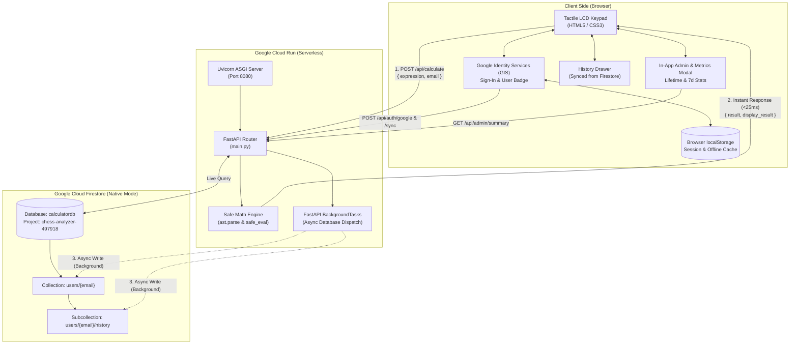

# Calculator Architecture & Design Document

## 1. Project Genesis & Initial Design

The calculator project originated from a hand-drawn black-and-white sketch captured on October 23, 2026:

### Original Sketch Analysis & Requirements
* **Keypad Layout:**
  * **Top Row:** `7`, `8`, `9`
  * **Middle Row:** `6`, `5`, `4`
  * **Lower Row:** `3`, `2`, `1`
  * **Bottom-Left:** An oversized, tall `0` key
  * **Operator Column (Right side):** `√` (square root) at top-right, followed by `×` (multiplication), `−` (subtraction), `+` (addition), and `=` (equals) at the bottom.
* **Aesthetics:** Hand-drawn tactile keypad vibe with shaded boundary regions, inspiring a retro hardware calculator style with 3D tactile buttons and an LCD digital display.

---

## 2. Core Architectural Decisions

### Decision 1: Backend Technology — Python (FastAPI)
* **Choice:** **Python 3.11 with FastAPI + Uvicorn**.
* **Rationale:**
  * Clean, fast, modern asynchronous ASGI framework.
  * Native Python math capabilities (arbitrary precision integer arithmetic, standard math library).
  * Safe AST expression evaluation engine.
  * Native support for `BackgroundTasks` to decouple database I/O from computation latency.

### Decision 2: Deployment Target — Google Cloud Run (Serverless)
* **Choice:** **Google Cloud Run (Managed Platform)**.
* **Service:** `cloud-calculator` in project `chess-analyzer-497918`, region `us-central1`.
* **Rationale:**
  * **Zero Cost at Rest:** Configured with `--min-instances 0`, allowing the container to scale down to zero when idle.
  * **Containerized Portability:** Packaging the Python backend and web UI into a Docker container guarantees identical behavior locally and on GCP.
  * **Automatic HTTPS & Scaling:** Instant provisioning of public `https://*.run.app` endpoint with automatic TLS.

### Decision 3: Identity & Authentication — Google Identity Services (GIS)
* **Choice:** **Google OAuth 2.0 Web Client ID** with ID Token verification.
* **Rationale:**
  * One-tap and button-driven sign-in requiring zero custom password handling.
  * Server-side cryptographic token verification (`google.oauth2.id_token.verify_oauth2_token`) without storing client secrets.
  * Displays user profile avatar, name, and email in an interactive header badge.
  * Automatic session restore via browser `localStorage` paired with background backend synchronization (`POST /api/auth/sync`).

### Decision 4: Persistent Database — Google Cloud Firestore (`calculatordb`)
* **Choice:** **Serverless Google Cloud Firestore (Native Mode)** in project `chess-analyzer-497918`.
* **Database Schema:**
  * **`users` (Collection):**
    * Document ID: `{email}`
    * Fields: `email`, `name`, `picture`, `login_count`, `calculation_count`, `first_seen`, `last_seen`, `last_active`.
  * **`users/{email}/history` (Subcollection):**
    * Documents: `{expression, result, timestamp, created_at: SERVER_TIMESTAMP}`.
* **Rationale:**
  * Fully serverless with generous free tier (50k reads/20k writes per day free).
  * Seamless IAM-based authentication on Cloud Run (zero credentials or passwords required in production).
  * Private history per user that persists across devices and serverless container restarts.

### Decision 5: Low-Latency Execution — Asynchronous Background Tasks
* **Choice:** **FastAPI `BackgroundTasks` for Firestore I/O**.
* **Rationale:**
  * Running synchronous remote gRPC database writes on every `=` keypress caused 200–400ms of network latency.
  * By computing results in memory (~0.1ms) and dispatching Firestore updates as background tasks, user-facing calculation response time was reduced to **< 25ms** while preserving 100% data durability.

### Decision 6: Analytics & Monitoring — In-App Admin Modal & Dashboard
* **Choice:** Dual-surface Admin view (in-app modal via `📊 Admin` button + standalone `/admin` page).
* **Metrics Provided:**
  * **Lifetime Totals:** Total Users, Total Sessions (Logins), Total Calculations.
  * **Last 7 Days Activity:** Active Users (7d), Sessions (7d), Calculations (7d).
  * **Granular Logs:** Full expandable calculation audit log per user with timestamps.

### Decision 7: Safe Math Engine — Python AST Parsing (No Unsafe `eval`)
* **Choice:** **Abstract Syntax Tree (AST) Traversal (`ast.parse`)**.
* **Rationale:** Custom recursive AST evaluator (`safe_eval()`) strictly whitelists safe binary operators (`+`, `-`, `*`, `/`, `**`, `%`), unary operators, and explicit math functions (`sqrt`, `abs`, `round`), eliminating Remote Code Execution (RCE) vectors.

---

## 3. System Architecture Diagram

---

## 4. Key Artifacts & File Map

* [`main.py`](file:///home/rahil/calculator/main.py): FastAPI backend server, AST math engine, Google OAuth verification, Firestore integration, and Admin metrics endpoints.
* [`static/app.js`](file:///home/rahil/calculator/static/app.js): Client-side event handling, Google Sign-in flow, in-app Admin modal controller, and LCD formatting.
* [`static/index.html`](file:///home/rahil/calculator/static/index.html): Semantic layout reproducing the sketch keypad, Google login gate, and Admin modal structure.
* [`static/style.css`](file:///home/rahil/calculator/static/style.css): 3D tactile button styling, LCD backlighting, glassmorphism login overlay, and Admin metric cards.
* [`Dockerfile`](file:///home/rahil/calculator/Dockerfile): Lightweight `python:3.11-slim` container definition.
* [`deploy_cloud_run.sh`](file:///home/rahil/calculator/deploy_cloud_run.sh): Automated one-step deployment script with Firestore and OAuth environment variables.
* [`requirements.txt`](file:///home/rahil/calculator/requirements.txt): Python dependencies (`fastapi`, `uvicorn`, `google-auth`, `google-cloud-firestore`, `requests`).
* [`assets/calculator_design_sketch.png`](file:///home/rahil/calculator/assets/calculator_design_sketch.png): Original hand-drawn reference sketch.
