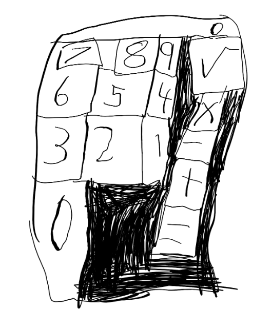
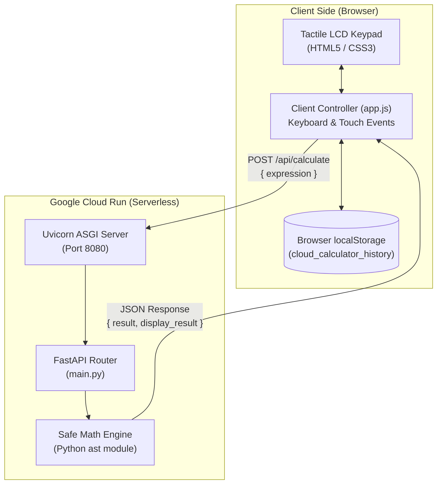

# Calculator Architecture & Design Document

## 1. Project Genesis & Initial Design

The calculator project originated from a hand-drawn black-and-white sketch captured on October 23, 2026 at ~10:30 PM:

### Original Sketch Analysis & Requirements
* **Keypad Layout:**
  * **Top Row:** `7`, `8`, `9`
  * **Middle Row:** `6`, `5`, `4`
  * **Lower Row:** `3`, `2`, `1`
  * **Bottom-Left:** An oversized, tall `0` key
  * **Operator Column (Right side):** `√` (square root) at top-right, followed by `×` (multiplication), `−` (subtraction), `+` (addition), and `=` (equals) at the bottom.
* **Aesthetics:** Hand-drawn tactile keypad vibe with shaded boundary regions, inspiring a retro hardware calculator style with 3D tactile buttons and an LCD digital display.

---

## 2. Core Architectural Decisions

### Decision 1: Backend Technology — Python (FastAPI)
* **Context:** The application required a robust math engine that could be deployed to the cloud, handle non-trivial math parsing safely, and serve static assets efficiently.
* **Choice:** **Python 3.11 with FastAPI + Uvicorn**.
* **Rationale:**
  * Clean, fast, modern asynchronous ASGI framework.
  * Native Python math capabilities (arbitrary precision integer arithmetic, standard math library).
  * Built-in automatic OpenAPI documentation and simple static asset mounting (`app.mount("/static")`).

### Decision 2: Deployment Target — Google Cloud Run (Serverless)
* **Context:** Evaluated 4 deployment architectures on GCP:
  1. Google Cloud Run (Serverless container)
  2. Firebase Hosting (Pure static frontend)
  3. Google Cloud Storage + External HTTPS Load Balancer
  4. Cloud Functions v2 + Hosting
* **Choice:** **Google Cloud Run (Option 1)**.
* **Rationale:**
  * **Zero Cost at Rest:** Configured with `--min-instances 0`, allowing the container to scale down to zero when idle (within the 2M free requests/month tier; estimated cost: $0.00/mo).
  * **Containerized Portability:** Packaging the Python backend and web UI into a Docker container guarantees identical behavior locally and on GCP.
  * **Automatic HTTPS:** Instant provisioning of public `https://*.run.app` endpoint without needing DNS or certificate management.

### Decision 3: State Storage — Client-Side (`localStorage`) over Server Memory
* **Context:** The original backend maintained calculation history in server memory (`history_db = []`). Because Cloud Run is serverless and scales to 0 instances when idle, any server-side in-memory state is erased on container shutdown or cold restart. Furthermore, multiple concurrent containers do not share memory.
* **Choice:** **Client-Side Storage in browser `localStorage`** (with fallback in-memory cache for API sync).
* **Rationale:**
  * **Persistence Across Scale-to-Zero:** User history survives container idle shutdowns and browser refreshes without requiring an external database.
  * **Zero Database Cost:** Avoided provisioning Firestore, Cloud SQL, or Memorystore, which would add ongoing costs or complexity.
  * **Privacy & Isolation:** Each user's calculation history remains stored strictly on their device.
  * **Offline Capability:** History remains visible and manageable even during brief network interruptions.

### Decision 4: Safe Math Engine — Python AST Parsing (No Unsafe `eval`)
* **Context:** Evaluating mathematical string expressions on a web backend is a notorious security hazard if implemented with Python's native `eval()` function (Remote Code Execution vulnerability).
* **Choice:** **Abstract Syntax Tree (AST) Traversal (`ast.parse`)**.
* **Rationale:**
  * Custom recursive AST evaluator (`safe_eval()`) strictly whitelists safe binary operators (`+`, `-`, `*`, `/`, `**`, `%`), unary operators, and explicit math functions (`sqrt`, `abs`, `round`).
  * Any arbitrary statement, import, attribute lookup, or executable code is immediately rejected before execution.
  * Safely catches division-by-zero errors and malformed syntax.

### Decision 5: UI/UX & Functional Refinements
* **Operator Mapping:** Swapped `%` to division (`÷`) on the keypad layout based on user feedback to provide standard four-function math operations alongside square root (`√`).
* **Tactile Skeuomorphic Design:** Designed with CSS bevels, drop shadows, inset active button presses, and an LCD backlit screen.
* **Personalized Branding:**
  * Header credit preserved exactly as requested: `"disined by Aarav and Rahil"`.
  * Calculator moniker updated to `"World's best Calculator"`.
* **Calculation History Management:**
  * Slide-out drawer/modal for calculation logs.
  * Added individual entry deletion (`delete` button per item) in addition to bulk history clear.

---

## 3. System Architecture Diagram

---

## 4. Key Artifacts & File Map

* [`main.py`](file:///home/rahil/calculator/main.py): FastAPI server, safe AST expression evaluation engine, and static file serving.
* [`static/app.js`](file:///home/rahil/calculator/static/app.js): Client-side event handling, LCD formatting, and `localStorage` persistence.
* [`static/index.html`](file:///home/rahil/calculator/static/index.html): Semantic layout faithfully reproducing the sketch keypad arrangement.
* [`static/style.css`](file:///home/rahil/calculator/static/style.css): 3D tactile button styling, LCD backlighting, and responsive mobile-first grid.
* [`Dockerfile`](file:///home/rahil/calculator/Dockerfile): Lightweight `python:3.11-slim` container definition.
* [`deploy_cloud_run.sh`](file:///home/rahil/calculator/deploy_cloud_run.sh): Automated one-step deployment script for Google Cloud Run.
* [`assets/calculator_design_sketch.png`](file:///home/rahil/calculator/assets/calculator_design_sketch.png): Original hand-drawn reference sketch.
