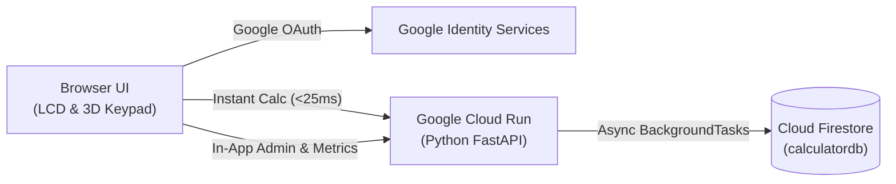

# Cloud Calculator (Google Cloud Run + Firestore)

A responsive, production-ready web calculator matching the hand-drawn sketch layout, built with **Python (FastAPI)**, **Google Identity Services (OAuth 2.0)**, and **Google Cloud Firestore**, deployed to **Google Cloud Run**.

---

## Architecture Overview



- **Runtime:** Python 3.11 with FastAPI + Uvicorn.
- **Authentication:** Google OAuth 2.0 (Google Identity Services) with server-side token verification and user profile tracking.
- **Database:** Google Cloud Firestore (Native Mode, `calculatordb`) storing persistent user profiles and private calculation histories.
- **Performance:** Sub-25ms calculation turnaround time via FastAPI `BackgroundTasks` (asynchronous database persistence).
- **Admin & Metrics:** In-app modal (`📊 Admin`) and standalone dashboard (`/admin`) displaying lifetime totals (users, sessions, calculations) and last-7-day active metrics.
- **Security:** Mathematical expressions parsed via Python's Abstract Syntax Tree (`ast` module) — strictly whitelisted operators, no `eval()`.
- **Cost:** Scales to zero when idle (`--min-instances 0`), running within GCP free tiers.

---

## Project Structure

```
/home/rahil/calculator/
├── main.py                 # FastAPI backend, AST engine, Firestore sync, Admin API
├── requirements.txt        # Python dependencies (FastAPI, Google Auth, Firestore)
├── Dockerfile              # Production container build for Google Cloud Run
├── .dockerignore           # Excluded build files
├── .gitignore              # Git ignore rules (protects credentials & keys)
├── deploy_cloud_run.sh     # Automated Cloud Run deployment script
├── DESIGN.md               # Detailed architectural design & decisions document
├── README.md               # Quickstart and overview
└── static/
    ├── index.html          # HTML5 layout, Google Sign-in gate, Admin modal
    ├── style.css           # 3D tactile buttons, LCD backlight, metric cards
    └── app.js              # Keypad bindings, Google auth sync, in-app admin logic
```

---

## Local Development

1. **Activate the virtual environment:**
   ```bash
   cd /home/rahil/calculator
   source venv/bin/activate
   ```

2. **Authenticate with Google Cloud (for local Firestore access):**
   ```bash
   gcloud auth application-default login
   ```

3. **Run the development server:**
   ```bash
   uvicorn main:app --reload --port 8000
   ```

4. **Open in browser:**
   Navigate to [http://localhost:8000](http://localhost:8000).

---

## Deploying to Google Cloud Run

To deploy updates to Google Cloud Run:

```bash
cd /home/rahil/calculator
./deploy_cloud_run.sh
```

The script automatically:
1. Validates your active GCP project (`chess-analyzer-497918`).
2. Enables necessary GCP APIs (`run.googleapis.com`, `cloudbuild.googleapis.com`).
3. Builds the Docker container via Cloud Build.
4. Deploys to Cloud Run with `GOOGLE_CLIENT_ID`, `GCP_PROJECT`, and `FIRESTORE_DATABASE` configured.
