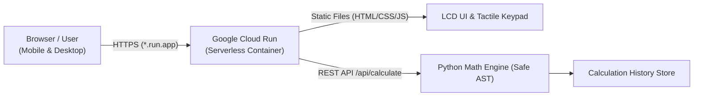

# Cloud Calculator (Google Cloud Run)

A responsive, production-ready web calculator matching the hand-drawn sketch layout, built with **Python (FastAPI)** and ready for deployment to **Google Cloud Run**.

---

## Architecture Overview



- **Runtime:** Python 3.11 with FastAPI + Uvicorn.
- **Frontend:** Vanilla HTML5, modern CSS3 (3D tactile keypad, LCD display, responsive), and ES6 JavaScript.
- **Keypad Layout:** Directly maps the user's sketch:
  - Top row: `7`, `8`, `9`, `√`
  - Middle row: `6`, `5`, `4`, `×`
  - Lower row: `3`, `2`, `1`, `−`
  - Bottom row: `0` (tall zero), `.`, `%`, `+`
  - Right action strip: `√`, `×`, `−`, `+`, `=`
- **Security:** Expressions are parsed into an Abstract Syntax Tree (AST) using Python's `ast` module; no arbitrary code execution or `eval()` vulnerability.
- **Cost:** Scales to zero when not receiving requests (free tier eligible: 2 million requests/month free).

---

## Project Structure

```
/home/rahil/calculator/
├── main.py                 # FastAPI backend server with math engine & history
├── requirements.txt        # Frozen Python dependencies
├── Dockerfile              # Production container build for Google Cloud Run
├── .dockerignore           # Excluded files for clean builds
├── deploy_cloud_run.sh     # One-step GCP deployment script
├── README.md               # Documentation & guide
└── static/
    ├── index.html          # Web UI markup matching hand-drawn sketch
    ├── style.css           # 3D tactile buttons, LCD backlight, responsive layout
    └── app.js              # Keyboard shortcuts, client state, and API sync
```

---

## Local Development

1. **Activate the virtual environment:**
   ```bash
   cd /home/rahil/calculator
   source venv/bin/activate
   ```

2. **Run the development server:**
   ```bash
   uvicorn main:app --reload --port 8080
   ```

3. **Open in browser:**
   Navigate to [http://localhost:8080](http://localhost:8080).

---

## Deploying to Google Cloud Run

### Prerequisites
1. Install the Google Cloud SDK (`gcloud`) if not already installed:
   ```bash
   sudo apt-get install -y google-cloud-cli
   ```
2. Log in and configure your project:
   ```bash
   gcloud auth login
   gcloud config set project YOUR_PROJECT_ID
   ```
3. Enable Cloud Run and Cloud Build APIs (one-time):
   ```bash
   gcloud services enable run.googleapis.com cloudbuild.googleapis.com
   ```

### Option A: Run the deployment script
```bash
cd /home/rahil/calculator
./deploy_cloud_run.sh
```

### Option B: Deploy with a single `gcloud` command
```bash
cd /home/rahil/calculator
gcloud run deploy cloud-calculator \
    --source . \
    --region us-central1 \
    --platform managed \
    --allow-unauthenticated \
    --memory 512Mi \
    --cpu 1 \
    --min-instances 0 \
    --max-instances 5
```

Once deployment completes, Cloud Run will print your shareable public URL:
```
Service URL: https://cloud-calculator-xxxxxx-uc.a.run.app
```
